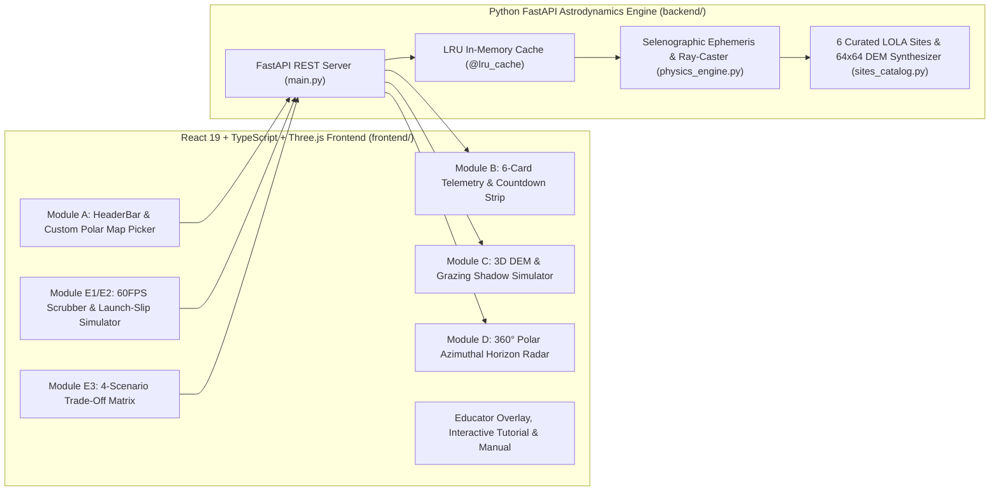

# LUNA-NAV // User Guide, Operations Playbook & Technical Manual

> [!IMPORTANT]
> **LUNA-NAV** is a monolithic full-stack aerospace web application (**Python FastAPI Astrodynamics Backend + React 19 / TypeScript / Three.js / Recharts Frontend**) built for the **2026 NASA Space Apps Challenge ("Lunar Landing Site Navigator")**.

---

## 1. System Architecture Overview

---

## 2. Step-by-Step Interactive Tutorial Walkthrough

You can launch this tutorial directly inside the application by clicking the **"Interactive Tutorial"** button in the top-right header, or follow the 4 steps below:

### Step 1: Evaluate the Artemis III Primary Candidate (Shackleton Connecting Ridge)
1. In the **Site Selector** dropdown (top-left of the scenario bar), select **`Shackleton Connecting Ridge (-89.54°, +2150m)`** and set **Landing UTC** to **`2026-12-01`** with a **`30d (1 Lunar Day)`** duration.
2. Observe **Module B (Telemetry Strip)**:
   - **Mission Sunlight** exceeds **88%–100%** during southern lunar summer because the $+2,150\text{ m}$ ridge stands above surrounding crater basins.
   - **Max Eclipse** remains well below the **50.0-hour** lander survival battery threshold, earning an **`OPTIMAL SITE`** verdict.

### Step 2: Inspect the 3D Grazing Shadows & 360° Polar Azimuthal Sky-Chart
1. Click **`PLAY 60FPS`** (or drag **Slider 1: Mission Elapsed Time Scrubber**) in the bottom dock and select **`5x`** or **`20x`** speed.
2. Watch **Module C (3D Lunar Terrain DEM)**:
   - The golden directional Sun light circles $360^\circ$ around the horizon at a grazing angle of $\sim 1.5^\circ$, casting long shadows across the $64 \times 64$ regolith mesh.
   - Click **`Lander Horizon`** in the top-right of the 3D viewport to place your camera right above the lander deck looking out at the crater rims.
3. Watch **Module D (360° Polar Azimuthal Radar)**:
   - The **dark slate polygon** represents the $360^\circ$ mountain horizon mask $H(\text{Az})$.
   - The **gold ring** traces the Sun's $360^\circ$ path around the sky; whenever the gold Sun marker dips outside the gray terrain polygon, the lander enters a local topographic eclipse.
   - The **cyan loop** centered near $0^\circ\text{ N}$ traces Earth's **27.3-day optical libration wobble**, showing why Earth periodically dips below local northern ridges.

### Step 3: Test Hardware Solar Array Geometry at $89^\circ\text{S}$ vs. Apollo 11
1. Click the **`Hardware: Vertical 360° Mast`** button in the top scenario bar.
2. Switch **Solar Array Geometry** from **`Vertical Cylindrical Mast (cos El)`** to **`Horizontal Flat Deck (sin El)`**.
3. Notice **Card 3 (Array Power)**:
   - At a $+1.5^\circ$ grazing Sun angle, a horizontal deck panel's incidence efficiency drops to $\sin(1.5^\circ) \approx 2.6\%$, slashing electrical output from **$\sim 4.5\text{ kW}$ down to $\sim 0.12\text{ kW}$**!
4. Now switch the **Site Selector** to **`Apollo 11 – Mare Tranquillitatis (+0.67°)`**:
   - The 360° Polar Radar automatically switches to an **Equatorial Zenith Projection ($-10^\circ$ to $+90^\circ$)**.
   - The Sun climbs to $+88^\circ$ overhead at lunar noon (where flat deck panels work great), followed by **330+ hours (14 Earth days) of continuous frigid darkness** (`CRITICAL RISK` for non-nuclear landers), while Earth stays high overhead at $+64^\circ$ (`100%` DTE comms).

### Step 4: Simulate a Launch Slip ("Schedule Cliff") & Run a 4-Site Trade Study
1. Select **`Nobile Crater Rim (-85.20°, +1900m)`** or **`Leibnitz Beta Plateau (-85.40°, +3200m)`**.
2. Drag **Slider 2: Launch Schedule Slip Simulator** from **`0d Nominal`** toward **`+10d Delay`** while watching the **Schedule Cliff Sensitivity Curve** on the bottom-right.
3. Scroll down to **Module E3 (Multi-Site & Schedule Trade-Off Matrix)** and click **`Load 4-Site Artemis Trade Study Preset`** (or click **`Pin to Trade-Off Matrix`** on any custom scenario) to compare up to 4 candidate sites side-by-side and automatically badge the **`RECOMMENDED SITE`**.

---

## 3. Flight Operations & Mission Planning Playbook

| Operational Metric | Nominal Threshold | Caution / Marginal | Critical Risk / Flight Rule Violation |
| :--- | :--- | :--- | :--- |
| **Solar Illumination Window** | $\ge 75\%$ of surface stay | $50\% - 74\%$ | $< 50\%$ illumination |
| **Max Continuous Eclipse** | $\le 50.0\text{ hours}$ (Rechargeable Li-Ion spec) | $50.1 - 120.0\text{ hours}$ | $> 120.0\text{ hours}$ (Requires RTG / Nuclear) |
| **Direct-to-Earth (DTE) Link** | $\ge 70\%$ (with $\ge 1.0^\circ$ multipath margin) | $35\% - 69\%$ | $< 35\%$ (Requires Lunar Relay Satellite) |
| **Composite Viability Score** | $\ge 72.0 / 100$ (`OPTIMAL`) | $45.0 - 71.9$ (`MARGINAL`) | $< 45.0$ (`CRITICAL_RISK`) |

---

## 4. Technical Engineering Reference

### 4.1 Mathematical Physics Models ([physics_engine.py](file:///c:/Users/avawe/Downloads/Luna%20Nav/backend/physics_engine.py))
- **Selenographic Coordinate Transformation:**
  Transforms J2000 ICRF ephemeris vectors (`skyfield` `de421.bsp` with deterministic IAU 2015 / ELP2000 analytical fallback) into the IAU Mean Earth / Polar Axis (`MOON_ME`) frame using Cassini libration harmonics $E_1 \dots E_{10}$, then projects onto the site's local East-North-Up ($\text{ENU}$) tangent plane.
- **Atmosphereless 360° Ray-Caster & Curvature Drop:**
  $$H(\text{Az}) = \max_{d \in (0, d_{\max}]} \arctan\left(\frac{Z(x_0 + d\sin\text{Az}, y_0 + d\cos\text{Az}) - Z(x_0, y_0) - \frac{d^2}{2 R_{\text{moon}}}}{d}\right)$$
  Bounded below by the spherical horizon dip angle $\theta_{\text{dip}} = -\arccos\left(\frac{R_{\text{moon}}}{R_{\text{moon}} + \max(0, h_{\text{rel}})}\right)$.
- **Partial Solar Disk Limb Occlusion ($r_\odot = 0.266^\circ$):**
  $$f_{\text{sun}}(t) = \text{clip}\left(\frac{\text{El}_{\text{sun}}(t) - H(\text{Az}_{\text{sun}}(t)) + r_\odot}{2 r_\odot}, 0.0, 1.0\right)$$
- **Hardware-Aware Electrical Output:**
  $$P_{\text{kW}}(t) = \frac{1361 \cdot f_{\text{sun}}(t) \cdot \eta_{\text{inc}}(\text{El}_{\text{sun}}) \cdot A_{\text{array}} \cdot 0.28}{1000}$$

### 4.2 Codebase File Map
- **Backend (`backend/`)**
  - [main.py](file:///c:/Users/avawe/Downloads/Luna%20Nav/backend/main.py): FastAPI application exposing `GET /api/sites`, `POST /api/evaluate`, `POST /api/compare`, and `POST /api/launch-slip-sweep`.
  - [physics_engine.py](file:///c:/Users/avawe/Downloads/Luna%20Nav/backend/physics_engine.py): Selenographic ephemeris solver, 360° DEM ray-caster, solar array power model, and LRU cache.
  - [sites_catalog.py](file:///c:/Users/avawe/Downloads/Luna%20Nav/backend/sites_catalog.py): 6 curated LOLA reference sites + deterministic $64 \times 64$ terrain heightmap generator.
- **Frontend (`frontend/src/`)**
  - [App.tsx](file:///c:/Users/avawe/Downloads/Luna%20Nav/frontend/src/App.tsx): Master Mission Control state orchestrator and 60 FPS playback engine.
  - [HeaderBar.tsx](file:///c:/Users/avawe/Downloads/Luna%20Nav/frontend/src/components/HeaderBar.tsx): Site selector, interactive South Pole coordinate picker modal, hardware popover, and mode toggles.
  - [TelemetryStrip.tsx](file:///c:/Users/avawe/Downloads/Luna%20Nav/frontend/src/components/TelemetryStrip.tsx): 6 real-time KPI cards with Sunset/Sunrise and Earthset/Earthrise countdown badges.
  - [LunarTerrain3D.tsx](file:///c:/Users/avawe/Downloads/Luna%20Nav/frontend/src/components/LunarTerrain3D.tsx): React Three Fiber 3D regolith DEM mesh, dynamic grazing shadow light, and lander beacon.
  - [PolarSkyChart.tsx](file:///c:/Users/avawe/Downloads/Luna%20Nav/frontend/src/components/PolarSkyChart.tsx): 360° SVG azimuthal radar plotting terrain mask $H(\text{Az})$, Sun trajectory, and Earth libration loop.
  - [MissionTimelineDock.tsx](file:///c:/Users/avawe/Downloads/Luna%20Nav/frontend/src/components/MissionTimelineDock.tsx): Dual time/launch-slip sliders, Gantt operational status ribbon, and Recharts telemetry tracks.
  - [ComparisonMatrix.tsx](file:///c:/Users/avawe/Downloads/Luna%20Nav/frontend/src/components/ComparisonMatrix.tsx): Side-by-side 4-scenario trade-off matrix and comparative KPI bar chart.
  - [EducatorOverlay.tsx](file:///c:/Users/avawe/Downloads/Luna%20Nav/frontend/src/components/EducatorOverlay.tsx): Guided physics cards, interactive 4-step tutorial modal, and in-app Operations & Technical Manual.
