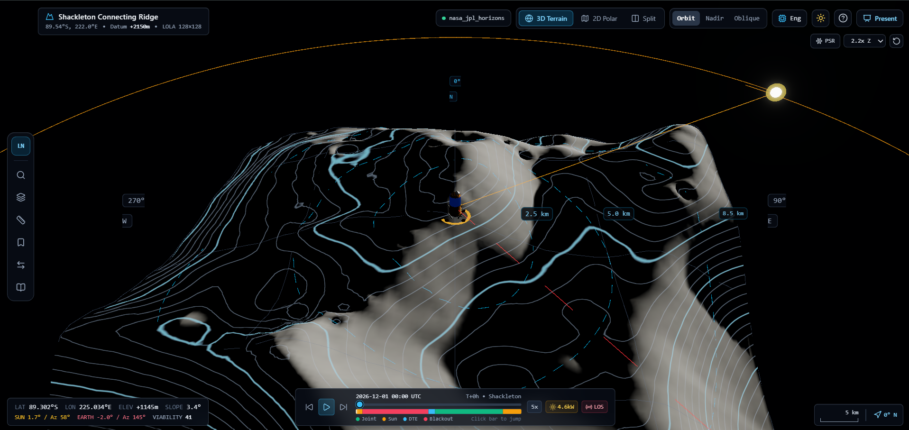
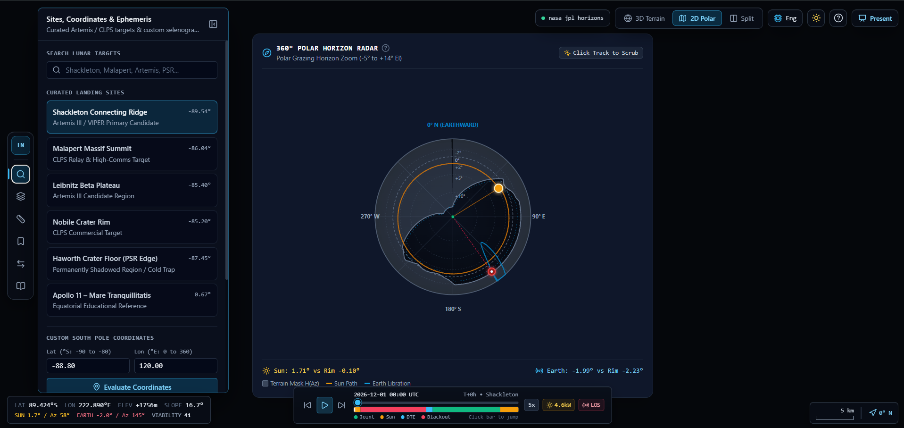
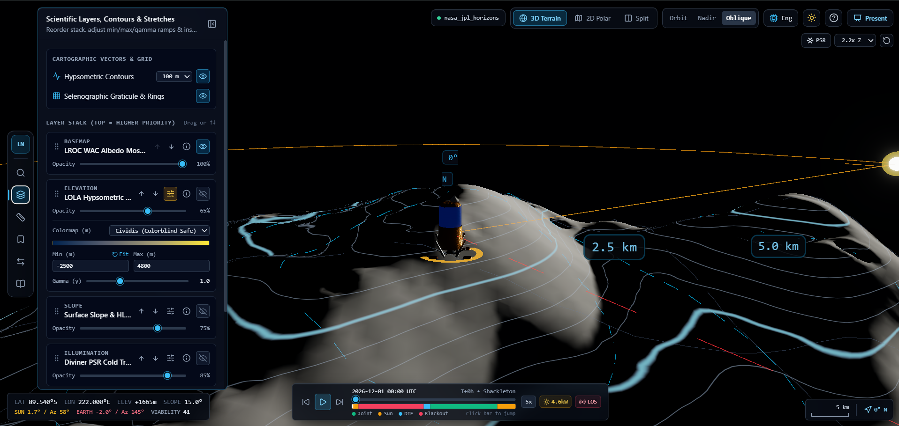
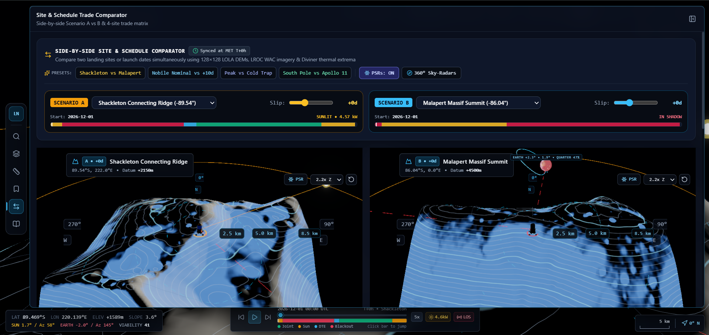

# LUNA-NAV - Lunar Landing Site & Operations Navigator

**A web workbench that shows when the Sun and Earth are visible from candidate lunar south-pole landing sites, so mission planners and learners can compare sites and launch dates.**

Built for the **NASA Space Apps Challenge Kandy 2026**, challenge: **"Lunar Landing Site Navigator"**, by **Team Cyone**.

<!-- LIVE DEMO (optional): [Open the live demo](https://your-demo-link-here) -->

---

## 1. Screenshots

<!-- TODO: capture these from the running app and save them in documentation/screenshots/ -->

| 3D terrain viewport | 2D polar sky radar |
| :---: | :---: |
|  |  |

| Layers and measurement tools | Site comparison |
| :---: | :---: |
|  |  |

<!-- Optional: add a short GIF of the time slider moving shadows across the terrain -->
<!--  -->

---

## 2. What it does

At the lunar south pole the Sun skims along the horizon, so a few metres of height decide whether a lander gets power or sits in darkness. LUNA-NAV calculates, for any chosen site and date range, where the Sun and Earth appear in the local sky and whether the surrounding terrain blocks them.

- **Sun and Earth tracking:** topocentric positions from the JPL DE421 ephemeris (Skyfield), including Earth libration and the Moon's 1.54° axial tilt, with a built-in analytical fallback when offline.
- **Terrain horizon ray-casting:** a 360° horizon is computed from the elevation grid at 1° steps, including lunar curvature.
- **Mission outputs:** sunlit hours, Earth-link (direct-to-Earth) uptime, longest eclipse, battery survival margin, and thermal risk for shadowed areas.
- **Solar array comparison:** vertical mast, dual-axis tracker, and flat deck.
- **Launch slip simulator:** shift the launch date from −14 to +28 days to reveal schedule cliffs.
- **Interactive 3D terrain:** real-time shadows, PSR cold-trap overlay, contours, a selenographic grid, and camera presets (Orbit, Nadir, Oblique).
- **Scientific workbench:** layer manager with opacity and colour-stretch controls, distance, area, circle and elevation-profile tools, and bookmarks.
- **Scenario comparison:** Scenario A vs B side by side, plus a trade matrix of up to four pinned scenarios.
- **Sharing and export:** shareable URL for the exact view, annotated PNG snapshot, JSON mission report, CSV timeline, and a clean "Present" mode for demos.

**Curated sites:** Shackleton Connecting Ridge, Malapert Massif Summit, Leibnitz Beta Plateau, Nobile Crater Rim, Haworth Crater Floor (PSR edge), and Apollo 11 – Mare Tranquillitatis, plus custom coordinates.

**Keyboard shortcuts:** `S` Sites, `L` Layers, `T` Tools, `B` Bookmarks/Export, `C` Compare, `G` Guide, `Space` play/pause, `←` `→` step time, `Esc` close or exit.

---

## 3. NASA data and services used

| Data / service | Used for | Link |
| :--- | :--- | :--- |
| **LRO LOLA** (Lunar Orbiter Laser Altimeter) south-pole elevation model, 80 m/pixel | Terrain mesh, slopes, and horizon ray-casting | https://pds-geosciences.wustl.edu/missions/lro/lola.htm |
| **NASA SVS 4720: CGI Moon Kit** (LOLA elevation and LROC colour mosaics) | Downloadable DEM and albedo texture source (`backend/fetch_nasa_data.py`) | https://svs.gsfc.nasa.gov/4720 |
| **LRO LROC** albedo imagery | Surface texture draped on the 3D terrain | https://science.nasa.gov/mission/lro/ |
| **JPL Horizons API** | Sun and Earth positions as seen from the Moon | https://ssd.jpl.nasa.gov/horizons/ |
| **NAIF SPICE DE421 kernel** (`de421.bsp`) | Offline planetary ephemeris used by Skyfield |  |
| **LRO Diviner** (reference for cold-trap temperatures) | Basis for the thermal-risk threshold (below 70 K) | https://www.diviner.ucla.edu/ |

**Design inspiration:** [NASA Moon Trek](https://trek.nasa.gov/moon/) and [LROC QuickMap](https://quickmap.lroc.asu.edu/).

> **Data fidelity note:** the thermal values are a procedural approximation driven by the computed illumination, calibrated to Diviner-like ranges (about 220 K sunlit, about 40 K in permanent shadow). They are not raw Diviner measurements. When the LOLA GeoTIFF is unavailable, the app falls back to a smaller south-pole crop, then to a calibrated procedural surface, so it always runs offline.

---

## 4. Install and run

### Requirements
- **Python 3.10 or newer** (developed on 3.12)
- **Node.js 20 or newer** with npm

### Step 1: Backend (port 8000)

```bash
cd backend
python -m venv .venv

# Windows:
.venv\Scripts\activate
# macOS / Linux:
# source .venv/bin/activate

pip install -r requirements.txt
python -m uvicorn main:app --reload --port 8000
```

The API is then available at `http://localhost:8000`, with interactive docs at `http://localhost:8000/docs`.

> The repository currently includes a `backend/venv` folder from development. It is safe to ignore and use a fresh `.venv` as shown above.

### Step 2: Frontend (port 5173)

```bash
cd frontend
npm install
npm run dev
```

Open `http://localhost:5173`. To point the interface at a different backend, create `frontend/.env` with `VITE_API_BASE_URL=http://your-host:8000/api`.

If the backend is not running, the frontend still works with a built-in fallback engine, so the interface remains interactive offline.

### Optional: refresh NASA data files

The needed GeoTIFFs are already in `backend/data/`. To download fresh crops from NASA SVS:

```bash
cd backend
python fetch_nasa_data.py
```

### Production build

```bash
cd frontend
npm run build
```

---

## 5. Tech stack and tools

| Layer | Tools |
| :--- | :--- |
| **Frontend** | React, TypeScript, Vite, Tailwind CSS, lucide-react icons, Recharts |
| **3D graphics** | Three.js via react-three-fiber and drei, custom GLSL terrain shader, post-processing effects, Web Worker for terrain maths |
| **Backend** | Python, FastAPI, Uvicorn, Pydantic |
| **Science and data** | Skyfield (JPL DE421), NumPy, SciPy, Pillow, requests; rasterio is optional |
| **Data formats** | GeoTIFF elevation and albedo rasters, JSON over REST |
| **Browser storage** | localStorage for theme and bookmarks, URL state for shareable views |

### API endpoints

| Method | Route | Purpose |
| :--- | :--- | :--- |
| GET | `/api/health` | Service status |
| GET | `/api/sites` | Curated landing sites |
| POST | `/api/evaluate` | Full mission evaluation for one site |
| POST | `/api/compare_scenarios` | Two scenarios evaluated together |
| POST | `/api/compare` | Site comparison |
| POST | `/api/launch-slip-sweep` | Launch-date sweep |

### Project structure

```
LUNA-NAV/
├── backend/
│   ├── main.py              FastAPI app and routes
│   ├── physics_engine.py    Ephemeris, horizon ray-casting, power and thermal logic
│   ├── horizons_client.py   JPL Horizons client with retries
│   ├── lola_dem.py          LOLA GeoTIFF loader
│   ├── data_ingestion.py    Elevation and texture processing
│   ├── sites_catalog.py     Curated sites and terrain patches
│   ├── fetch_nasa_data.py   NASA SVS download helper
│   └── data/                GeoTIFF elevation and albedo files
├── frontend/
│   └── src/
│       ├── App.tsx          Workbench layout and state
│       ├── components/      3D terrain, polar chart, panels, toolbars
│       ├── workers/         Terrain horizon Web Worker
│       ├── api/client.ts    Backend client with offline fallback
│       └── utils/           Exports and shareable URL helpers
└── documentation/           Guides, science notes, and diagrams
```

More detail is available in [`documentation/`](documentation/README.md): UI encyclopedia, science background, decision playbook, student lab guide, and technical architecture.

---

## 6. Team and challenge

**Challenge:** Lunar Landing Site Navigator, NASA Space Apps Challenge Kandy 2026
**Team:** Team Cyone

| Member | Role |
| :--- | :--- |
| Tharindu Weerasinghe | Lead Developer |
| Gayasha Sandeepa | UI Developer |
| Navoda Perera | Project Lead |
| Rashmi Nisansala | Research Lead |
| Nihindu Perera | System Architect |
| Lakshani Gunathilake | Pitch Deck Designer |

---

## 7. AI tools used

<!-- TODO: list every AI tool the team used and what it was used for. Judges expect this section. -->

| Tool | Used for |
| :--- | :--- |
| Claude AI | Drafting code prompts, README, and documentation |
| Gemini AI | Research and Idea Investigation, Code completion |
| ChatGPT | Field Research |

All scientific logic, data choices, and final design decisions were reviewed by the team.

---

## 8. Live demo

<!-- TODO: add the link if the app is deployed; otherwise delete this section. -->
Live demo: *coming soon*

---

*Built with NASA open data for the NASA Space Apps Challenge Kandy 2026.*