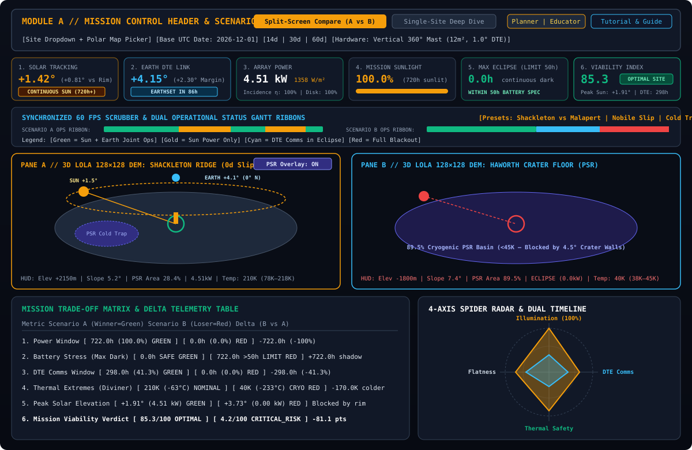
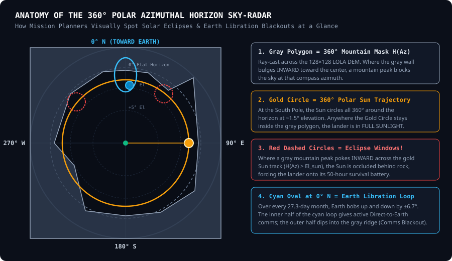

# 01 // UI Encyclopedia & Visual Guide: What Everything Shows & How to Read It

This guide walks through every screen, panel, card, color code, 3D indicator, and chart in **LUNA-NAV**. When you look at the application, use this reference to understand exactly what each element depicts and how to interpret the numbers.

---

## 1. Global Color Code & Visual Language

LUNA-NAV uses a standardized **Mission Control Dark Theme** (`#0B0F19` space slate background, `#111827` telemetry panels) where every color carries a specific physical meaning across all 3D viewports, 2D charts, and tables:

| Color | Hex Code | Physical Meaning in LUNA-NAV | What It Tells You Instantly |
| :--- | :--- | :--- | :--- |
| **Solar Gold / Amber** | `#F59E0B` | **The Sun / Solar Power / Scenario A** | Represents the Sun’s position, solar elevation track, sunlit operational hours, and Scenario A in side-by-side comparisons. |
| **Earth Cyan / Sky Blue** | `#38BDF8` | **The Earth / Direct-to-Earth (DTE) Comms / Scenario B** | Represents the Earth’s position, optical libration track, radio communication link windows, and Scenario B in comparisons. |
| **Nominal Emerald Green** | `#10B981` | **Nominal / Joint Operations / Category Winner** | Both Solar Power AND Earth Communications are simultaneously active (`Joint Operational`), battery stress is safe ($\le 50\text{h}$), or this scenario wins a Trade-Off category. |
| **Eclipse Crimson Red** | `#EF4444` | **Eclipse / Blackout / Survival Violation** | The Sun or Earth is blocked behind a lunar mountain/crater rim, battery darkness exceeds the $50\text{h}$ survival limit, or surface temperature drops into a lethal cryogenic regime ($<70\text{ K}$). |
| **Cryo Indigo / Violet** | `#6366F1` | **Permanently Shadowed Region (PSR Cold Trap)** | Marks deep polar crater floors in the 3D terrain that never receive sunlight and stay near $40\text{ K}$ ($-233^\circ\text{C}$). |

---

## 2. Module A: Top Mission Control Header & Scenario Control Bar

Located at the very top of the screen (`frontend/src/components/HeaderBar.tsx`), this bar controls *where* you are landing, *when* you are landing, *what hardware* your lander carries, and *how* you view the workspace.

### 2.1 Top Row: Branding, Engine Status & Mode Switchers
1. **Ephemeris & Dataset Status Badge** (e.g., `DE421 + LOLA 128ppd + DIVINER + LROC` or `IAU + LOLA 128ppd + DIVINER + LROC`):
   - **What it shows:** Confirms that the backend is actively running the selenographic ephemeris solver alongside the $128 \times 128$ LOLA Digital Elevation Model (`south_pole_dem.tif`), procedural Diviner thermal model, and LROC visual albedo textures (`south_pole_visual.tif`).
2. **Primary Workspace View Switcher (`Split-Screen Compare (A vs B)` vs. `Single-Site Deep Dive`):**
   - **`Split-Screen Compare (A vs B)` (Default):** Opens the **Comparison-First Dashboard** where two scenarios (two different sites, or the same site on two different launch dates) are evaluated head-to-head with synchronized 3D viewports, a delta Trade-Off Matrix, and a 4-axis Spider/Radar chart.
   - **`Single-Site Deep Dive`:** Opens a full-width analysis of a single landing site featuring the large 3D DEM viewport, full-size 360° Polar Azimuthal Sky-Chart, 4-track mission timeline, and the `-14d to +28d` **Schedule Cliff Sensitivity Curve**.
3. **Persona Mode Toggle (`Planner` vs. `Educator`):**
   - **`Planner` (Engineering Mode):** Clean, high-density telemetry layout for rapid trade studies.
   - **`Educator` (Public Explorer Mode):** Activates the **Interactive Lunar South Pole Physics Guide** banner below the KPI strip with 1-click comparative experiments explaining grazing sunlight, Earth libration, solar panel geometry, and cold traps.
4. **`Tutorial` Button:** Opens a 4-step interactive walkthrough modal that configures live scenarios on your screen with 1 click.
5. **`Ops & Tech Guide` Button:** Opens an in-app 3-tab reference manual covering the User Interface, Flight Rules, and Mathematical Equations.

### 2.2 Bottom Row: Mission Scenario & Hardware Controls
1. **`Primary (A):` / `Site:` Dropdown:**
   - Lets you select from **6 curated lunar sites** (each showing its latitude and elevation in meters relative to the Moon's mean radius of $1,737.4\text{ km}$) or click **`+ Custom Coordinates / Polar Map Picker...`**.
   - **Custom Coordinates Modal:** Allows you to either type any `(Latitude, Longitude, Elevation, Morphology)` OR **click directly on an interactive 80°S–90°S South Pole radar map** to drop a pin and extract a $128 \times 128$ terrain patch.
2. **`Base UTC:` Date Picker:**
   - Sets the nominal target touchdown date (`YYYY-MM-DD`). Because the Moon has a $29.53\text{-day}$ synodic (solar) month, a $27.21\text{-day}$ draconic (nodal) month, and an $18.6\text{-year}$ nodal precession cycle, changing the landing date changes where both the Sun and Earth sit relative to local mountains.
3. **Mission Duration Buttons (`14d`, `30d (1 Lunar Day)`, `60d`):**
   - **`14d`:** Half a lunar day (typical short commercial CLPS mission).
   - **`30d (1 Lunar Day)`:** One complete $29.5\text{-Earth-day}$ lunar solar cycle ($360^\circ$ rotation of the Sun around the sky).
   - **`60d`:** Two full lunar days (long-duration Artemis base camp or rover stay).
4. **`Hardware:` Configuration Popover:**
   - **Solar Array Geometry:**
     - *Vertical Cylindrical Mast ($360^\circ$ Polar Optimal, $\cos\text{El}$):* A tall vertical cylinder covered in solar cells that intercepts horizontal grazing sunlight from all $360^\circ$ directions without needing to rotate.
     - *Dual-Axis Sun-Tracking Gimbal ($\eta_{\text{inc}} = 1.0$):* Mechanically steered solar wings that always point directly at the Sun.
     - *Horizontal Flat Deck (Equatorial Classic, $\sin\text{El}$):* Flat solar panels mounted horizontally on the lander deck (like Apollo or equatorial landers).
   - **Solar Array Area ($\text{m}^2$):** Total photovoltaic surface area ($2\text{ m}^2$ to $60\text{ m}^2$, default $12\text{ m}^2$) assuming $28\%$ efficient triple-junction GaAs solar cells.
   - **DTE Antenna Clearance Margin ($\text{deg}$):** Minimum angle above the local mountain ridge ($0.0^\circ$ to $5.0^\circ$, default $1.0^\circ$) required for a clean Direct-to-Earth radio link without surface multipath reflections.
5. **`Pin to 4-Site Matrix (N/4)` Button:**
   - Snapshots your current active configuration into the bottom 4-scenario comparison pinboard so you can compare up to 4 candidate sites/dates at once.

---

## 3. Module B: Real-Time Operational KPI & Countdown Strip

Located directly beneath the header (`frontend/src/components/TelemetryStrip.tsx`), these **6 high-contrast telemetry cards** update in real time at 60 FPS as you drag the timeline scrubber.

### Card 1: Solar Tracking & Sunset/Sunrise Countdown
- **Top Right (`Az 142.5°`):** The compass direction of the Sun right now ($0^\circ = \text{North/Earthward}$, $90^\circ = \text{East}$, $180^\circ = \text{South}$, $270^\circ = \text{West}$).
- **Large Number (`+1.42°`):** Current **Topocentric Sun Elevation Angle** above the mathematical flat horizon ($0^\circ$).
- **Parenthetical (`+0.81° vs Rim`):** **Terrain Clearance Angle** ($\Delta\theta = \text{El}_{\text{sun}} - H(\text{Az}_{\text{sun}})$).
  - *How to interpret:* If this number is **positive** (e.g., `+0.81°`), the Sun is above the mountain ridge at that azimuth. If **negative** (e.g., `-1.20°`), a mountain or crater wall is blocking the Sun!
- **Live Countdown Badge:**
  - `CONTINUOUS SUN (720h+)` (Amber): The Sun never sets behind any mountain for the rest of the mission window.
  - `SUNSET IN 142h` (Amber): You are currently in sunlight, but in 142 hours the Sun’s azimuth will move behind a mountain peak and trigger an eclipse.
  - `ECLIPSE — SUNRISE IN 18h` (Flashing Crimson): You are currently in shadow; the Sun will emerge from behind the ridge in 18 hours.

### Card 2: Earth DTE Link & Earthset/Earthrise Countdown
- **Top Right (`Az 356.2°`):** Compass direction of Earth (at the South Pole, Earth always hovers near $0^\circ$ North, wobbling left and right by $\pm 7.9^\circ$).
- **Large Number (`+4.15°`):** Current **Topocentric Earth Elevation Angle**.
- **Parenthetical (`+2.30° Margin`):** How far Earth is above the required **Terrain Horizon + Antenna Clearance Margin** ($\text{El}_{\text{earth}} - [H(\text{Az}_{\text{earth}}) + \theta_{\text{margin}}]$).
- **Live Countdown Badge:**
  - `EARTHSET IN 86h` (Cyan): Direct-to-Earth radio link is active now, but Earth’s downward libration wobble will dip below the northern ridge in 86 hours.
  - `COMMS BLACKOUT — RISE IN 34h` (Flashing Crimson): Direct-to-Earth communications are blocked by terrain; requires an orbital relay satellite (like Lunar Gateway or a CLPS relay orbiter) for the next 34 hours.

### Card 3: Array Power (Instantaneous Electrical Output)
- **Large Number (`4.56 kW`):** Electrical power being generated *at this exact mission hour* by your chosen solar array hardware.
- **Amber Readout (`1358 W/m²`):** Effective solar irradiance hitting the panels after accounting for partial limb eclipses and panel incidence angle.
- **Bottom Left (`Incidence η: 100%`):** Geometric efficiency of your solar array orientation at the current Sun elevation ($\cos\text{El}$ for vertical mast, $1.0$ for tracking, $\sin\text{El}$ for flat deck).
- **Bottom Right (`Sun Disk: 100%`):** Fractional visibility $f_{\text{sun}} \in [0\%, 100\%]$ of the $0.53^\circ$-wide solar disk above the mountain ridge. Between $1\%$ and $99\%$, the Sun is experiencing a grazing partial eclipse along a mountain peak!

### Card 4: Mission Sunlight (Total Illumination Window)
- **Large Number (`91.4%`):** Percentage of the entire mission duration that the lander receives sunlight.
- **Parenthetical (`(658h sunlit)`):** Total cumulative hours of solar illumination across the mission.
- **Top Right (`DTE: 69.5%`):** Percentage of the mission with Direct-to-Earth radio visibility.
- **Progress Bar:** Visualizes the sunlit fraction of the mission.

### Card 5: Max Eclipse (Battery Stress Indicator)
- **Large Number (`24.0h continuous dark`):** The **single longest uninterrupted period of darkness** during the entire mission.
- **Why this is the #1 survival metric:** A lander’s rechargeable lithium-ion batteries only need to survive the *longest single eclipse* before sunlight returns to recharge them. Standard lunar landers carry **50.0 hours** of battery survival storage.
- **Visual Alert:**
  - If **$\le 50.0\text{h}$**: Card border is calm dark slate and displays `WITHIN SURVIVAL BATTERY MARGIN` in emerald green.
  - If **$> 50.0\text{h}$**: Card turns **crimson red**, the battery icon bounces, and it warns `EXCEEDS 50h LANDER BATTERY SPEC`—meaning a conventional battery-powered lander will freeze and die during that eclipse unless equipped with nuclear radioisotope (RTG) power!

### Card 6: Viability Index (Composite Mission Score)
- **Large Score (`85.3 / 100`):** Weighted composite score combining Illumination ($40\%$), Battery Eclipse Survival ($25\%$), DTE Communications ($20\%$), and Thermal Safety ($15\%$).
- **Verdict Badge:**
  - `OPTIMAL SITE` (Green Shield): Score $\ge 70$ and Max Eclipse $\le 50\text{h}$. Ready for mission selection.
  - `MARGINAL / CAUTION` (Amber Triangle): Score $45–69$ or Max Eclipse $50–130\text{h}$. Requires heavy battery capacity, orbital comms relay, or launch window tuning.
  - `CRITICAL RISK` (Red Octagon): Score $< 45$ or Max Eclipse $> 130\text{h}$. High probability of loss of mission without nuclear power.

---

## 4. Module C: 3D Lunar Terrain DEM & Grazing Ray-Cast Simulator

Built with Three.js (`frontend/src/components/LunarTerrain3D.tsx`), this viewport renders the actual $128 \times 128$ local patch ($20\text{ km} \times 20\text{ km}$) extracted from NASA LOLA elevation data (`south_pole_dem.tif`) and draped with the LROC Wide Angle Camera surface texture (`south_pole_visual.tif`).

### 4.1 What You See Inside the 3D Scene
1. **The Displaced 3D Regolith Mesh:**
   - The $20\text{ km} \times 20\text{ km}$ lunar surface centered on the landing site (`[0, 0, 0]`). Mountains, ridges, crater rims, and basins cast real-time geometric shadows across the terrain as the Sun moves.
2. **The Lander Beacon & Animated Status Ring (Center of Terrain):**
   - At the exact center sits a 3D miniature lunar lander whose top structure changes shape to match your selected **Solar Array Geometry** (a golden vertical cylinder, a cyan rotating solar wing, or a flat blue deck).
   - Surrounding the lander is a pulsing **Telemetry Status Ring**:
     - **Green Ring:** Both Sun Power and Earth Comms are active (`Joint Operational`).
     - **Gold Ring:** Sun Power is active, but Earth Comms are blocked by terrain.
     - **Cyan Ring:** Earth Comms are active, but the lander is in solar eclipse (running on battery).
     - **Red Ring:** Total blackout (both Sun and Earth are occluded by mountains).
3. **The Glowing Gold Sun Sphere & Ray Vector:**
   - Shows the exact topocentric direction of the Sun in the 3D sky dome.
   - The **faint gold ring/arc** in the sky traces the Sun’s complete trajectory over the mission duration. At the South Pole, you can literally see this gold ring forms a horizontal $360^\circ$ halo just above the horizon!
   - When the Sun is visible, a **solid gold ray** connects the Sun to the lander. When blocked by a mountain, the ray turns **dashed red**.
4. **The Glowing Blue Earth Sphere & Libration Loop:**
   - Shows the exact topocentric direction of Earth near the northern ($0^\circ\text{ N}$) horizon.
   - The **cyan loop** in the sky traces Earth’s $27.3\text{-day}$ optical libration ellipse, showing how Earth bobs up and down above the northern terrain.
5. **Cardinal Compass Labels (`N (0° EARTH)`, `E (90°)`, `S (180°)`, `W (270°)`):**
   - Anchored around the perimeter of the $20\text{ km} \times 20\text{ km}$ terrain patch so you always know which direction is North (toward Earth).

### 4.2 Interactive 3D Viewport Controls (Top-Right of 3D Panel)
- **`Show PSRs` / `PSRs Active` Toggle Button (Snowflake Icon):**
  - **What it does:** Toggles the **Permanently Shadowed Region (PSR) Cold-Trap Hazard Overlay**.
  - **How to interpret:** When turned ON, every crater floor and deep depression in the $20\text{ km} \times 20\text{ km}$ patch that stays permanently hidden from the grazing polar Sun is painted in a **vivid cryogenic indigo-blue hue** (`<70 K`). Mission planners use this to visually verify that their landing zone is safely perched on an illuminated ridge while still close enough for a rover to drive down into a nearby blue PSR to prospect for water ice!
- **Camera Viewpoint Switcher (`Orbital Tactical` vs. `Lander Horizon`):**
  - **`Orbital Tactical`:** Bird’s-eye oblique view high above the $20\text{ km} \times 20\text{ km}$ patch so you can see shadows sweeping across the entire crater landscape.
  - **`Lander Horizon`:** Moves the camera down onto the lunar surface right next to the lander looking outward toward the northern crater rim, Sun, and Earth—giving you a "lander’s-eye view" of the horizon!
- **Vertical Exaggeration Selector (`1.0x Scale`, `2.5x Relief`, `4.0x Relief`):**
  - Amplifies vertical mountain heights ($2.5\times$ default) so subtle $1.5^\circ$ grazing ridges and crater bowls stand out clearly during visual inspection.
- **Bottom-Left HUD Telemetry Pill:**
  - Displays Site Elevation (`+2150m`), Mean Terrain Slope (`5.2°`), PSR Cold-Trap Area (`28.4%` of the $20\text{ km}$ patch), instantaneous Power (`4.51kW` or `ECLIPSE`), DTE Link status, and **Instantaneous Local Surface Temperature (`local_temp_k`, e.g., `210K` sunlit vs. `40K` in shadow)**.

---

## 5. Module D: 360° Polar Azimuthal "Pilot's Radar" Sky-Chart

Located in `frontend/src/components/PolarSkyChart.tsx` (visible in Single-Site Deep Dive mode and via the **`Show 360° Sky-Radars`** button in Split-Screen Compare mode), this custom SVG polar plot is the **primary geometric instrument** used by real NASA/ESA mission analysts.

### 5.1 How the Polar Coordinate System Works
Imagine lying on your back at the landing site looking up at the sky dome, or looking at a radar scope centered on your lander:
- **Around the Perimeter (Angle = Compass Azimuth):**
  - Top ($12\text{ o'clock}$) = **$0^\circ\text{ North}$ (Always pointing toward the mean Earth direction)**.
  - Right ($3\text{ o'clock}$) = **$90^\circ\text{ East}$**.
  - Bottom ($6\text{ o'clock}$) = **$180^\circ\text{ South}$**.
  - Left ($9\text{ o'clock}$) = **$270^\circ\text{ West}$**.
- **From Outer Edge Toward Center (Radius = Elevation Angle above Horizon):**
  - **Outer Rim** = Lowest elevation angle (`-5°` below flat horizon for South Pole sites; `-10°` for Equatorial sites).
  - **Towards the Center** = Higher elevation in the sky (`+2°`, `+5°`, `+10°`, `+14°` for South Pole sites; up to `+90°` zenith for Equatorial sites like Apollo 11).
  - *Why Polar Sites Zoom to `-5° .. +14°`:* At the Lunar South Pole, all the action happens between $-2^\circ$ and $+7^\circ$ near the horizon! Zooming the radial axis to $[-5^\circ, +14^\circ]$ magnifies those critical $1^\circ$ mountain peaks so you can read sub-degree grazing clearances effortlessly.

### 5.2 The 5 Layers Plotted on the Radar
1. **The Dark Slate Filled Polygon near the Outer Edge (`Terrain Mask H(Az)`):**
   - Represents the $360^\circ$ local mountain and crater rim skyline ray-cast from the $128 \times 128$ LOLA DEM.
   - **Rule of Thumb:** **Anything inside the clear dark-blue center is visible in the sky. Anything that crosses outward into the gray shaded polygon is blocked behind a lunar mountain!**
2. **The Dashed Gray Circle labeled `0°`:**
   - The theoretical flat horizon ($0^\circ$ elevation). Where the gray mountain polygon bulges *inward* past the `0°` circle (e.g., reaching `+2°` or `+4°`), a tall mountain peak or crater wall rises above the horizon at that compass azimuth.
3. **The Dashed Cyan Ring just inside the Terrain Mask:**
   - Represents $H(\text{Az}) + \theta_{\text{margin}}$ (the terrain skyline plus your required $1.0^\circ$ DTE antenna clearance margin). Earth must stay *inside* this dashed cyan boundary for interference-free radio communications.
4. **The Gold Path & Glowing Gold Sun Marker (`360° Sun Path`):**
   - Traces the Sun’s path `(sun_az, sun_el)` across the entire mission.
   - At South Pole sites, this forms a **complete $360^\circ$ gold circle** around the chart!
   - By following the gold circle around the clock face, you can immediately spot every azimuth where a gray mountain peak pokes *inward* across the gold line—**those intersections are your exact solar eclipse windows!**
5. **The Cyan Loop & Glowing Blue Earth Marker (`Earth Libration Loop`):**
   - Located near $0^\circ\text{ North}$ (top of the radar), this cyan oval/figure-8 traces Earth’s $27.3\text{-day}$ optical libration wobble.
   - If the entire cyan loop stays inside the gray terrain mask (as at **Malapert Massif**), you get nearly $100\%$ continuous Earth communications. If the outer half of the cyan loop crosses into the gray mountain wall (as at **Haworth Crater** or **Nobile Rim**), Earth sets behind the mountain for half of every month!

---

## 6. Module E: Temporal Scrubber, Launch-Slip Simulator & Multi-Track Charts

Located in `frontend/src/components/MissionTimelineDock.tsx` and `frontend/src/components/ScenarioCompareDashboard.tsx`.

### 6.1 Dual Interactive Sliders
1. **Slider 1 — Mission Elapsed Time Scrubber (`MET: T+0h` to `T+720h`):**
   - Moves forward or backward through the mission hour-by-hour.
   - **`PLAY 60FPS` / `PAUSE` + Speed Multipliers (`1x`, `5x`, `20x`):** Animates the entire dashboard continuously so you can watch shadows sweep $360^\circ$ around the terrain and see the Sun/Earth markers orbit the Polar Radar.
2. **Slider 2 — Launch Schedule Slip Simulator (`-14d Early` to `+28d Delay`):**
   - Simulates what happens if a rocket scrub, weather delay, or orbital phasing change shifts your landing date by $-14$ to $+28$ days.
   - Dragging this slider immediately recomputes the ephemerides for the delayed start date and moves the vertical blue reference line across the **Schedule Cliff Sensitivity Curve**.

### 6.2 The Operational Status Gantt Ribbon (Track 4)
Directly beneath the Mission Elapsed Time slider is a horizontal color-coded bar spanning the entire mission from Hour 0 to Hour $N$:
- **Emerald Green Segment:** **Joint Operations** (Both Solar Power and Earth DTE Comms are active).
- **Amber Gold Segment:** **Sun Only** (Solar Power is active, but Earth is behind a ridge—store science data onboard or use an orbital relay).
- **Sky Cyan Segment:** **DTE Comms Only** (Earth link is active, but the Sun is eclipsed behind a mountain—high battery drain!).
- **Crimson Red Segment:** **Full Blackout** (Both Sun and Earth are blocked by terrain—survival heater mode only).
- **Interactive Shortcut:** **Click any colored segment on the ribbon** (for example, a red or cyan eclipse band) to jump the 3D viewport and Polar Radar directly to that exact hour and see which mountain peak is causing the shadow!

### 6.3 The 3 Synchronized Telemetry Charts (`Single-Site Deep Dive` View)
1. **Left Chart — `Track 1 & 2: Sun & Earth Elevation vs. Terrain Mask (°)`:**
   - Plots **Sun Elevation** (Gold line) and **Earth Elevation** (Cyan line) over time against the **Terrain Horizon Mask at the Sun's Azimuth** (Gray shaded area) and **DTE Horizon Threshold** (Dashed blue line).
   - *How to read:* Whenever the **gray shaded mountain area rises above the gold Sun line**, an eclipse occurs!
2. **Center Chart — `Track 3: Hardware Solar Power Generation (kW)`:**
   - Plots electrical power output in kilowatts over every hour of the mission. Dips to $0.0\text{ kW}$ mark eclipse periods; shallow dips mark partial grazing solar limb eclipses.
3. **Right Chart — `Schedule Cliff Sensitivity (-14d to +28d Slip)`:**
   - Plots how **Mission Viability Score** (Blue area), **Sunlight %** (Gold line), and **DTE Comms %** (Green dashed line) change across every possible launch delay from $-14$ days to $+28$ days.
   - *How to read:* A steep downward drop in the gold or blue curve is a **"Schedule Cliff"**—telling the Launch Director: *"If we do not launch within the next 4 days, our illumination drops from 85% to 40% and we must switch to our backup landing site!"*

---

## 7. The Split-Screen Comparison Dashboard (`ScenarioCompareDashboard.tsx`)

When in **`Split-Screen Compare (A vs B)`** mode (the default view), LUNA-NAV presents a dedicated head-to-head decision environment:

1. **Quick Trade-Study Preset Buttons (Top Right):**
   - `Shackleton vs Malapert` — Compares the highest-sunlight Artemis III ridge against the highest-comms CLPS relay mountain.
   - `Nobile Nominal vs +10d Slip` — Compares the exact same site on its target launch date vs. a 10-day launch delay.
   - `Peak of Light vs Cold Trap` — Compares sunlit Shackleton Ridge ($+2,150\text{ m}$) against permanently shadowed Haworth Crater Floor ($-1,800\text{ m}$).
   - `South Pole vs Apollo 11` — Compares $89.5^\circ\text{S}$ polar grazing physics against the $0.67^\circ\text{N}$ equatorial day/night cycle.
2. **Dual Synchronized 3D Viewports (`SCENARIO A` on Left, `SCENARIO B` on Right):**
   - Both 3D scenes are locked to the **same Mission Elapsed Time (`T+Xh`)**. When you press `SYNC PLAY 60FPS`, you can visually watch one landing site stay bathed in golden sunlight while the other falls into deep crater shadow.
3. **Mission Trade-Off Matrix & Delta Telemetry Table (Bottom Left):**
   - Compares the 6 core survival metrics side-by-side:
     1. **Power Window** (Total Sunlight Hours & %)
     2. **Battery Stress** (Max Continuous Eclipse vs. $\le 50.0\text{h}$ limit)
     3. **DTE Comms Window** (Total Earth Visibility Hours & %)
     4. **Thermal Extremes** (Surface Min/Max in Kelvin & Celsius, flagging $<70\text{ K}$ cryo hazards)
     5. **Peak Solar Elevation** (Max sun angle & average kW output)
     6. **Mission Viability Verdict** (`0–100` score & `OPTIMAL` / `MARGINAL` / `CRITICAL_RISK`)
   - **Color Coding:** The winning cell in each row is highlighted in **emerald green**, the losing cell in **red**, and the right-most column displays the exact mathematical **Delta (`B vs A`)** (e.g., `+204.0h (+28.2%)`).
4. **Normalized 4-Axis Structural Radar Chart (Bottom Right):**
   - Overlaps **Scenario A (Gold polygon)** and **Scenario B (Cyan polygon)** across four $0–100$ axes:
     - **`Illumination`** (Solar availability)
     - **`DTE Comms`** (Direct-to-Earth link availability)
     - **`Thermal Safety`** (Resistance to extreme cryogenic $<70\text{ K}$ or noon $>375\text{ K}$ temperatures)
     - **`Terrain Flatness`** (Landing pad slope safety derived from the $128 \times 128$ LOLA DEM gradients)
   - *How to read:* Whichever colored polygon encloses a larger, more balanced area across all 4 axes has the stronger overall structural design margin.

