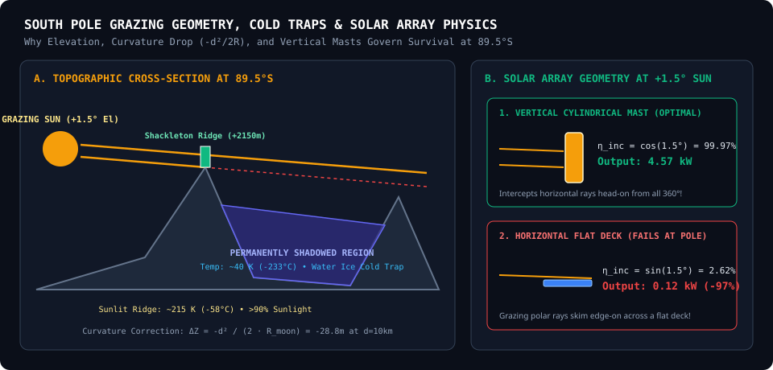

# 02 // The Science, Astrodynamics & Real-World Lunar Physics Guide

To make smart decisions in **LUNA-NAV**, it helps to understand *why* the Lunar South Pole behaves unlike anywhere on Earth—or even anywhere near the Moon's own equator (where the Apollo missions landed).

This guide explains the **6 fundamental physical phenomena** modeled inside LUNA-NAV (`backend/physics_engine.py` and `backend/data_ingestion.py`) and how they govern real spacecraft design.

---

## 1. Why the Sun Circles the South Pole Horizon ($1.54^\circ$ Axial Tilt)

### The Physics
- **Earth** has a large axial tilt (**$23.44^\circ$**) relative to the plane of its orbit around the Sun (the ecliptic). That is why Earth has dramatic summers and winters, and why the Sun rises up to $+23.4^\circ$ at Earth's poles in summer and sinks to $-23.4^\circ$ in winter.
- **The Moon**, by contrast, has a nearly upright spin axis tilted by only **$1.5424^\circ$** relative to the ecliptic (governed by **Cassini's Laws**, where the Moon's spin axis, orbital normal, and ecliptic normal remain coplanar as they precess every $18.6\text{ years}$).

### What This Means on the Lunar Surface
1. **At the Lunar Equator (`Apollo 11`, Lat $+0.67^\circ$):**
   - As the Moon rotates once every **$29.53\text{ Earth days}$** (one *synodic month*), the Sun rises in the East, climbs to nearly **$+89^\circ$ directly overhead** at lunar noon ($354\text{ hours}$ of blistering $+117^\circ\text{C}$ heat), sets in the West, and leaves the lander in **$354\text{ hours}$ ($14.7\text{ Earth days}$) of pitch-black, $-178^\circ\text{C}$ night**.
   - Almost no conventional battery can power a spacecraft through $354\text{ hours}$ of continuous darkness without nuclear radioisotope heaters/generators (RTGs).
2. **At the Lunar South Pole (`Shackleton Ridge`, Lat $-89.54^\circ$):**
   - Because you are standing at the bottom spin axis of the Moon and the Sun is only $\pm 1.54^\circ$ above or below the equator, **the Sun never rises high into the sky and never plunges deep below the horizon**.
   - Instead, over each $29.53\text{-day}$ lunar day, the Sun **skims horizontally $360^\circ$ around the compass** (North $\to$ West $\to$ South $\to$ East $\to$ North) like a lighthouse beam at grazing angles between **$-1.9^\circ$ and $+1.9^\circ$**!

---

## 2. "Peaks of Eternal Light" vs. "Permanently Shadowed Regions (PSRs)"

Because the polar Sun always skims within $\sim 1.5^\circ$ of the horizontal, **local topography is destiny**:

### 2.1 Elevated Peaks & Ridges (Peaks of Near-Eternal Light)
- The Moon is a small world (mean radius $R_{\text{moon}} = 1,737.4\text{ km}$, only $27\%$ of Earth's radius), so its horizon drops away rapidly due to spherical curvature.
- If you land on a high mountain peak or crater rim—such as **Shackleton Connecting Ridge ($+2,150\text{ m}$)** or **Malapert Massif ($+4,500\text{ m}$)**—you stand *above* the surrounding terrain.
- Even when the Sun is slightly below $0^\circ$, your elevated vantage point gives you a **negative geometric horizon dip**:
  $$\theta_{\text{dip}} = -\arccos\left(\frac{R_{\text{moon}}}{R_{\text{moon}} + h_{\text{rel}}}\right)$$
  For a $2,150\text{ m}$ ridge towering above a $-1,800\text{ m}$ basin ($h_{\text{rel}} \approx 3,950\text{ m}$), the horizon dips down to **$-1.22^\circ$**!
- As a result, during southern lunar summer, the Sun stays visible across **$85\%$ to $100\%$ of the entire $720\text{-hour}$ month**, blocked only briefly when its $360^\circ$ path passes behind a taller neighboring mountain peak.

### 2.2 Crater Floors & Basins (Permanently Shadowed Cold Traps)
- Just $3\text{ to }5\text{ km}$ away from Shackleton Ridge lies the floor of **Shackleton Crater** and **Haworth Crater ($-1,800\text{ m}$)**, surrounded by steep crater walls rising $+3.5^\circ\text{ to }+6.0^\circ$ above the horizon in all $360^\circ$ directions.
- Because the polar Sun never climbs higher than $\sim +1.9^\circ$ to $+3.7^\circ$, **a single solar photon has not touched the floor of Haworth Crater in over $2\text{ billion years}$**.
- **The Scientific Prize & Engineering Hazard:**
  - Without an atmosphere to conduct heat, these **Permanently Shadowed Regions (PSRs)** radiate heat into deep space until they equilibrate at **$26\text{ K to }45\text{ K}$ ($-247^\circ\text{C}$ to $-228^\circ\text{C}$)**—colder than the surface of Pluto!
  - At $<110\text{ K}$, water ice ($\text{H}_2\text{O}$) is stable in vacuum for billions of years. These PSRs act as **cryogenic cold traps** holding hundreds of millions of tons of ancient comet/solar-wind water ice needed for rocket propellant ($\text{LH}_2/\text{LOX}$) and astronaut life support.
  - **How LUNA-NAV Visualizes This:** Clicking **`Show PSRs`** in the 3D viewport paints these $<70\text{ K}$ cold traps in **indigo-blue** so you can land on the sunlit gold ridge right next to the blue ice trap—giving rovers access to water ice without freezing the lander!

---

## 3. Why Lunar Curvature & 360° Ray-Casting Matter

In `backend/data_ingestion.py`, LUNA-NAV does not assume a flat Moon. When checking whether a distant mountain at distance $d$ blocks the Sun or Earth, it applies the exact **lunar sphere curvature drop-off**:

$$H(\text{Az}) = \max_{d \in (0, d_{\max}]} \arctan\left(\frac{Z(x_0 + d\sin\text{Az}, y_0 + d\cos\text{Az}) - Z(x_0, y_0) - \overbrace{\frac{d^2}{2 R_{\text{moon}}}}^{\text{Curvature Drop}}}{d}\right)$$

- **Practical Example:** At a distance of $d = 10\text{ km}$ ($10,000\text{ m}$) from the lander, the lunar surface drops downward by:
  $$\Delta Z_{\text{curve}} = \frac{(10,000)^2}{2 \times 1,737,400} \approx 28.8\text{ meters}$$
  At $d = 50\text{ km}$, the Moon's surface drops away by **$720\text{ meters}$**! Because LUNA-NAV includes this curvature term across all $360^\circ$ azimuth rays, distant mountains drop below the horizon accurately just as they do in real LOLA laser altimetry.

---

## 4. Partial Solar Limb Eclipses ($r_\odot = 0.266^\circ$)

On Earth, sunrise or sunset takes only about $2\text{ minutes}$ because the Sun crosses the horizon steeply.
At the Lunar South Pole, the Sun moves nearly **parallel** to the mountain ridges!
- The Sun is not a mathematical point; its visible disk has an angular radius (semi-diameter) of **$r_\odot \approx 0.266^\circ$** (total width $\approx 0.532^\circ$).
- When the center of the Sun ($\text{El}_{\text{sun}}$) skims within $\pm 0.266^\circ$ of a mountain ridge $H(\text{Az})$, half of the solar disk peeks above the ridge while the bottom half is occluded by lunar rock—creating a **grazing partial solar eclipse that can last for 6 to 18 hours**!
- LUNA-NAV models this fractional visibility $f_{\text{sun}}(t) \in [0, 1]$ continuously:
  $$f_{\text{sun}}(t) = \text{clip}\left(\frac{\text{El}_{\text{sun}}(t) - H(\text{Az}_{\text{sun}}(t)) + 0.266^\circ}{2 \times 0.266^\circ},\ 0.0,\ 1.0\right)$$
  You can watch this live in **Card 3 (`Sun Disk: XX%`)** of the Telemetry Strip!

---

## 5. Optical Libration: Why Earth Wobbles in the Lunar Sky

A common misconception is that because the Moon is tidally locked to Earth (always showing Earth the same face), Earth hangs completely motionless in the lunar sky. **It does not!**

### Why Earth Moves (Optical Libration)
1. **Latitudinal Libration ($\pm 6.68^\circ$ up and down every $27.21\text{ days}$):**
   - The Moon's orbit is inclined by $5.145^\circ$ to the ecliptic, and its spin axis is tilted by $1.542^\circ$ in the opposite direction ($5.145^\circ + 1.542^\circ = 6.687^\circ$).
   - Over each **$27.21\text{-day}$ draconic month**, Earth appears to bob up and down in elevation by **$13.4^\circ$ peak-to-peak** ($\pm 6.68^\circ$).
2. **Longitudinal Libration ($\pm 7.9^\circ$ left and right every $27.55\text{ days}$):**
   - Because the Moon's orbit is an ellipse (eccentricity $e = 0.0549$), its orbital speed varies (faster at perigee, slower at apogee) while its axial rotation speed is constant.
   - Over each **$27.55\text{-day}$ anomalistic month**, Earth swings east and west in azimuth by **$\pm 7.9^\circ$**.

### The Operational Consequence at the South Pole
- At the South Pole ($89.5^\circ\text{S}$), Earth's mean position is right on the northern horizon ($0^\circ\text{ N}$, mean elevation $\approx 0^\circ$).
- Because of latitudinal libration, for **$\sim 13.6\text{ days}$ of every month**, Earth rises up to **$+6.7^\circ$ above the northern horizon**, and for the **other $\sim 13.6\text{ days}$**, Earth sinks down to **$-6.7^\circ$ below the horizon**!
- Look at the **Cyan Earth Libration Loop** on LUNA-NAV’s **360° Polar Azimuthal Radar**:
  - At **Shackleton Ridge**, Earth is visible for $\sim 41\%$ to $50\%$ of the month (when libration is positive) and blocked when libration dips negative.
  - At **Malapert Massif** ($86.04^\circ\text{S}, 0^\circ\text{E}, +4,500\text{ m}$), because you are $4^\circ$ closer to the equator on the Earth-facing prime meridian and perched atop a $4.5\text{ km}$ mountain peak, the entire northern horizon drops away—boosting Direct-to-Earth (DTE) communications to **$\sim 70\%+$**!

---

## 6. Hardware Physics: Why Vertical Solar Arrays Beat Flat Decks by $38\times$

LUNA-NAV calculates electrical power output in kilowatts using the spacecraft photovoltaic equation:
$$P_{\text{kW}}(t) = \frac{G_{\text{sc}} \cdot f_{\text{sun}}(t) \cdot \eta_{\text{inc}}(t) \cdot A_{\text{array}} \cdot \eta_{\text{eff}}}{1000}$$
where $G_{\text{sc}} = 1361\text{ W/m}^2$ is the solar constant at $1\text{ AU}$, $A_{\text{array}}$ is array area (default $12\text{ m}^2$), and $\eta_{\text{eff}} = 0.28$ ($28\%$ triple-junction GaAs cells).

Look at how the **Incidence Factor $\eta_{\text{inc}}(t)$** behaves at a typical South Pole grazing Sun elevation of **$\text{El}_{\text{sun}} = +1.5^\circ$**:

| Solar Array Hardware Type | Incidence Law $\eta_{\text{inc}}$ | Efficiency at $\text{El}_{\text{sun}} = +1.5^\circ$ (South Pole) | Power Output ($12\text{ m}^2$) at $+1.5^\circ$ | Efficiency at $\text{El}_{\text{sun}} = +88^\circ$ (Equator Noon) |
| :--- | :--- | :--- | :--- | :--- |
| **1. Vertical Cylindrical Mast (`vertical_cylindrical`)** | $\cos(\text{El}_{\text{sun}})$ | **$\cos(1.5^\circ) = 99.97\%$** | **$4.57\text{ kW}$** | $\cos(88^\circ) = 3.5\%$ ($0.16\text{ kW}$) |
| **2. Dual-Axis Tracking Gimbal (`dual_axis_tracking`)** | $1.00$ | **$100.0\%$** | **$4.57\text{ kW}$** | **$100.0\%$ ($4.57\text{ kW}$)** |
| **3. Horizontal Flat Deck (`horizontal_deck`)** | $\sin(\text{El}_{\text{sun}})$ | **$\sin(1.5^\circ) = 2.62\%$** | **$0.12\text{ kW}$ (Fails!)** | $\sin(88^\circ) = 99.9\%$ ($4.57\text{ kW}$) |

> **Key Engineering Takeaway:** A flat horizontal solar panel mounted on top of a lander—which worked great near the equator on Apollo or Chang'e—loses **$97.4\%$ of its power** at the Lunar South Pole because the grazing $1.5^\circ$ sunlight skims edge-on across the flat panel! That is why NASA's VIPER rover, Artemis habitats, and polar CLPS landers mount solar arrays **vertically** like a tower or chimney.

