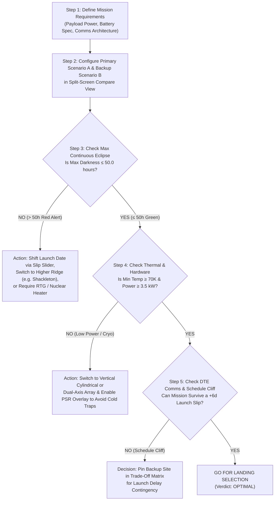

# 03 // Mission Decision-Making Playbook & Real Aerospace Case Studies

This guide explains how mission directors, flight dynamics officers, and spacecraft systems engineers use **LUNA-NAV** to make real **Go / No-Go landing site and launch window decisions**.

---

## 1. The 5-Step Mission Decision Framework

Whenever you evaluate a candidate lunar mission in LUNA-NAV, follow this exact 5-step engineering workflow:

---

## 2. Quick-Reference Flight Rules & Survival Thresholds

When looking at the **Telemetry Strip** or **Trade-Off Matrix**, use these industry-standard lunar lander thresholds to judge whether a number is good or bad:

| Metric | Where to Look in UI | Optimal (Green / Go) | Marginal (Amber / Caution) | Critical Violation (Red / No-Go) | Real Engineering Reason |
| :--- | :--- | :--- | :--- | :--- | :--- |
| **Max Continuous Eclipse** | Card 5 & Matrix Row 2 | **$\le 50.0\text{ hours}$** | $50.1\text{h} - 120.0\text{h}$ | **$> 120.0\text{ hours}$** | A $50\text{h}$ Li-Ion battery bank weighs $\sim 45\text{ kg}$. Surviving $>100\text{h}$ of darkness requires prohibitive battery mass or nuclear RTGs. |
| **Mission Sunlight %** | Card 4 & Matrix Row 1 | **$\ge 80.0\%$** | $50.0\% - 79.9\%$ | **$< 50.0\%$** | High duty cycle is required to run drills, mass spectrometers, and rovers while recharging batteries after brief eclipses. |
| **DTE Comms Window %** | Card 2 & Matrix Row 3 | **$\ge 65.0\%$** | $35.0\% - 64.9\%$ | **$< 35.0\%$** | Without a dedicated lunar relay satellite, DTE is the only way to command the lander and downlink science telemetry. |
| **Local Surface Temp (`local_temp_k`)** | 3D HUD & Matrix Row 4 | **$150\text{ K} - 310\text{ K}$** ($-123^\circ\text{C}$ to $+37^\circ\text{C}$) | $70\text{ K} - 149\text{ K}$ | **$< 70\text{ K}$ ($-203^\circ\text{C}$) or $> 375\text{ K}$** | Below $70\text{ K}$, standard aerospace electronics, lubricants, and battery electrolytes freeze solid without active radioisotope heating. |
| **Landing Pad Slope** | 3D HUD (`Slope: X.X°`) & Radar `Terrain Flatness` | **$\le 5.0^\circ$** | $5.1^\circ - 8.5^\circ$ | **$> 8.5^\circ$** | Tall landers (like SpaceX Starship HLS or Blue Moon) risk tipping over upon touchdown if local slope exceeds $5^\circ\text{ to }8^\circ$. |

---

## 3. Four Real-World Aerospace Case Studies (Try These Live!)

Each of these 4 case studies corresponds directly to one of the **Quick Preset Buttons** at the top of LUNA-NAV’s **Split-Screen Compare** dashboard.

---

### Case Study 1: The Classic South Pole Trade-Off — Power vs. Communications
**Preset Button:** Click **`Shackleton vs Malapert`** in the Split-Screen Compare bar.
- **Scenario A:** `Shackleton Connecting Ridge` ($89.54^\circ\text{S}, 222^\circ\text{E}, +2,150\text{ m}$) on `2026-12-01`
- **Scenario B:** `Malapert Massif Summit` ($86.04^\circ\text{S}, 0^\circ\text{E}, +4,500\text{ m}$) on `2026-12-01`

#### What You Observe in the UI:
1. **In the Trade-Off Matrix:**
   - **Row 1 (Power Window):** **Scenario A (Shackleton) wins in Green** with **$100.0\%$ ($722\text{h}$) sunlight** and **$0.0\text{h}$ eclipse**, whereas Scenario B (Malapert) has **$60.7\%$ ($438\text{h}$) sunlight** and experiences a multi-day shadow when the Sun moves south of the massif.
   - **Row 3 (DTE Comms Window):** **Scenario B (Malapert) wins in Green** with **$69.5\%$ ($502\text{h}$) Direct-to-Earth visibility**, beating Shackleton’s **$41.3\%$ ($298\text{h}$)** by **`+204.0 hours (+28.2%)`**!
2. **In the 4-Axis Structural Radar Chart:**
   - The **Gold Polygon (Shackleton)** stretches all the way to $100$ on the `Illumination` axis.
   - The **Cyan Polygon (Malapert)** stretches much further out on the `DTE Comms` axis.
3. **Click `Show 360° Sky-Radars` to See Why:**
   - On Shackleton’s radar, the gold Sun circle stays completely inside the gray terrain mask for all $360^\circ$, while half of the cyan Earth libration loop dips below the $0^\circ\text{ N}$ ridge.
   - On Malapert’s radar, because Malapert sits at $0^\circ$ longitude facing Earth at $+4,500\text{ m}$ elevation, the northern horizon at $0^\circ\text{ N}$ is wide open, keeping most of the cyan Earth loop visible!

#### How Mission Planners Decide:
- **Choose Shackleton Ridge (Scenario A)** if your mission has a **Lunar Orbital Relay Satellite** (like NASA’s Lunar Gateway or Lunaray) to handle communications when Earth dips below the ridge, because $100\%$ continuous solar power and $0\text{h}$ battery darkness guarantees survival.
- **Choose Malapert Massif (Scenario B)** if you are deploying a **Direct-to-Earth Communications Relay Tower** or a short-duration commercial lander during the sunlit half of Malapert’s month that must transmit high-definition video directly to Earth ground stations without an orbital relay.

---

### Case Study 2: Surviving a Rocket Launch Delay ("Schedule Cliff" Analysis)
**Preset Button:** Click **`Nobile Nominal vs +10d Slip`** in the Split-Screen Compare bar (or switch to **`Single-Site Deep Dive`** on `Nobile Crater Rim`).
- **Scenario A:** `Nobile Crater Rim` ($85.20^\circ\text{S}, 53.50^\circ\text{E}, +1,900\text{ m}$) — **Nominal Launch (`0d Slip`)**
- **Scenario B:** `Nobile Crater Rim` — **Delayed by 10 Days (`+10d Slip`)**

#### Real-World Scenario:
Your commercial lunar lander is stacked on the launch pad in Florida for a December 1 launch targeting **Nobile Crater Rim** (the actual NASA VIPER target region). Upper-level winds and a valve sensor scrub the launch by **10 days**. The Launch Director asks you: *"Can we still land at Nobile Rim on December 11, or will the shifted solar geometry kill our lander?"*

#### What You Observe in the UI:
1. Look at the **Dual Operational Status Ribbons** under the master time scrubber:
   - In **Scenario A (`0d Slip`)**, the mission begins during a long golden/green sunlit window, allowing the lander to touch down in bright sunlight, deploy its solar arrays, and complete primary science operations before the mid-mission shadow arrives.
   - In **Scenario B (`+10d Slip`)**, shifting touchdown by $+10\text{ days}$ shifts the red blackout bar right over the early mission phase and shifts the solar elevation curve relative to Nobile’s scalloped eastern/western mountain peaks!
2. Switch to **`Single-Site Deep Dive`** and look at the bottom-right **`Schedule Cliff Sensitivity (-14d to +28d Slip)`** chart:
   - You can see the exact sinusoidal wave of illumination and viability across the $29.5\text{-day}$ lunar cycle.

#### How Mission Planners Decide:
- Whenever a launch delay pushes your landing site into a red **Schedule Cliff** where `Max Eclipse` exceeds your battery limit or touchdown occurs in shadow, you use the **Trade-Off Matrix** to switch the delayed launch to a higher-latitude ridge (`Shackleton Connecting Ridge`) whose illumination curve stays flat at $>90\%$ across all launch slip dates!

---

### Case Study 3: Avoiding Cryogenic Death in a Permanently Shadowed Cold Trap
**Preset Button:** Click **`Peak of Light vs Cold Trap`** in the Split-Screen Compare bar.
- **Scenario A:** `Shackleton Connecting Ridge` ($+2,150\text{ m}$)
- **Scenario B:** `Haworth Crater Floor (PSR Edge)` ($-1,800\text{ m}$)

#### What You Observe in the UI:
1. **Look at the Right 3D Viewport (`SCENARIO B: Haworth Crater Floor`):**
   - With **`PSR Cold-Trap Overlay: ON`**, nearly **$89.5\%$ of the 3D terrain bowl glows in cryogenic indigo-blue**!
   - The lander beacon ring in the center is permanently **Red**, and the line to the Sun is a **dashed red occluded line** because the towering $4.2^\circ\text{ to }5.5^\circ$ crater walls block the $+1.9^\circ$ Sun across all $360^\circ$ of the compass.
2. **Look at the Trade-Off Matrix:**
   - **Power Window:** `0.0h (0.0%)` vs. Shackleton’s `722.0h (100.0%)`.
   - **Battery Stress:** `722.0h ⚠️ >50h LIMIT` (Complete battery depletion within 2 days of landing).
   - **Thermal Extremes (Row 4):** Haworth plunges to **`38.0K to 45.0K (-235°C to -228°C)`** (`EXTREME_CRYO_HAZARD` in crimson red), whereas sunlit Shackleton stays near **`210K (-63°C)`**.

#### How Mission Planners Decide:
- **Never land a solar-powered spacecraft inside a polar basin.** Instead, land on the illuminated rim/ridge (`Shackleton Ridge`, Scenario A) and send a tethered or battery-heated rover on short $12\text{-to-}24\text{ hour}$ sorties down into the adjacent blue PSR cold trap, returning to the sunlit ridge to warm up and recharge!

---

### Case Study 4: Polar Grazing Geometry vs. Equatorial Apollo Missions
**Preset Button:** Click **`South Pole vs Apollo 11`** in the Split-Screen Compare bar.
- **Scenario A:** `Shackleton Connecting Ridge` ($89.54^\circ\text{S}$)
- **Scenario B:** `Apollo 11 – Mare Tranquillitatis` ($+0.67^\circ\text{N}$)

#### What You Observe in the UI:
1. **Click `Show 360° Sky-Radars`:**
   - On **Scenario A (South Pole)**, the gold Sun path is a horizontal circle hugging the outer horizon at $+1.5^\circ$, while the cyan Earth loop sits right on the $0^\circ\text{ N}$ rim.
   - On **Scenario B (Apollo 11 Equator)**, the gold Sun path is a straight line cutting right across the center zenith of the sky (`+88.1°` overhead at noon!), and the cyan Earth loop sits high in the middle of the sky at **`+64°` elevation (`100.0%` DTE Comms)**!
2. **Test the Hardware Popover (`Hardware:` button in Top Bar):**
   - Switch **Solar Array Geometry** to **`Horizontal Flat Deck (Equatorial Classic, sin El)`**:
     - Notice that at **Shackleton (Scenario A)**, average power collapses from **$4.51\text{ kW}$ down to $0.12\text{ kW}$**!
     - Meanwhile, at **Apollo 11 (Scenario B)** during lunar noon, the flat deck generates the full **$4.57\text{ kW}$**—but then suffers **$330.0\text{ hours}$ ($14\text{ Earth days}$) of continuous equatorial night** (`⚠️ >50h LIMIT`)!
   - Switch **Solar Array Geometry** back to **`Vertical Cylindrical Mast (360° Polar Optimal, cos El)`**:
     - Shackleton immediately jumps back to **$4.51\text{ kW}$ continuous power** across the entire 30-day mission!

